# [Anti-interference]Key Technology for 6G! MIMO-OFDM ISAC Waveform Design, Efficient Sidelobe Reduction in Range-Doppler Environment[with MATLAB Code]

6G Key Technologies! MIMO-OFDM ISAC Waveform Design, Efficient Reduction of Sidelobes in Distance-Doppler. In the development process of 6G wireless communication, Integrated Sensing and Communications (ISAC) has become a core enabling technology for intelligent applications such as autonomous driving, extended reality (XR), smart cities, etc., due to its efficient use of hardware and spectrum. The MIMO-OFDM architecture, which combines high spectral efficiency with dimensionality independence in radar perception, becomes an optimal solution for ISAC practical deployment. However, the core challenge lies in: the dual-function waveform that carries communication information due to randomness will produce high distance-doppler sidelobes in the convolutional function, severely degrading radar perception performance.
To address this pain point, this paper proposes a MIMO-OFDM ISAC waveform design scheme based on symbol level precoding (SLP), fully exploiting temporal freedom to achieve sidelobe suppression. It also considers target illumination power, multi-user communication QoS, and constant modulus transmission constraints, ultimately proving the superiority of this scheme through simulation, providing a new technical path for the engineering implementation of ISAC.
1. Development background of ISAC: MIMO-OFDM is preferred, waveform design faces core challenges. ISAC breaks away from the traditional separation of perception and communication design by sharing resources across time, frequency, and space domains, significantly improving spectral efficiency, reducing hardware costs, and achieving cooperative gains, making it the core direction of 6G.
OFDM signals, due to their high spectral efficiency and strong resistance to frequency selective fading, have become the mainstream choice in communication systems such as 5G NR and IEEE 802.11; their multicarrier structure ensures the independence and orthogonality of spectral components, allowing distance and velocity estimation to be conducted in independent dimensions, also having advantages in radar perception. Coupled with the spatial freedom brought by MIMO antenna arrays, the MIMO-OFDM architecture becomes the most promising solution for realizing ISAC's dual functions.
2. Core contradiction in waveform design. The key challenge of MIMO-OFDM ISAC is balancing waveform and beamforming design between communication and perception performance:
Radar perception performance highly relies on the fuzzy function of the transmitted waveform. An ideal fuzzy function should present a "pincushion-like" shape—with narrow main lobe and low sidelobes. Commonly, deterministic sequences such as ZC sequences are used to implement this, but these sequences cannot carry random communication information;
Communication signals need to be random for enhancing information transmission efficiency. Direct application in ISAC can cause high sidelobes in the distance-Doppler plane, leading to weak targets being obscured and false alarm rates for "false targets" increasing.
Existing solutions still have flaws: Firstly, although mutual filtering can eliminate the impact of randomness in communication symbols, it can increase noise power; Secondly, combining pre-coded communication symbols with deterministic radar sequences through beamforming methods cannot completely eliminate interference between targets and users in complex scenarios like near proximity, still resulting in high sidelobes.
Symbol level precoding (SLP) as a nonlinear precoding technique not only utilizes user space channels but also combines transmission symbol information, providing additional degrees of freedom in both time and space domains for waveform design—it can convert harmful multi-user interference (MUI) into constructive interference (CI) to enhance communication QoS, and flexibly regulate the temporal characteristics of dual-function waveforms to suppress the distance-Doppler sidelobes of the fuzzy function, making it an ideal choice for ISAC dual-function waveform design.
II. System Model and Problem Formulation: Clarifying Optimization Objectives under Multi-Constraints
The MIMO-OFDM ISAC system considered in this paper features a base station equipped with an uniform linear array for transmitting/receiving OFDM signals containing subcarriers and symbols, serving K single antenna users in downlink communication services, and completing radar target detection and distance and velocity estimation through echo signals. The following outlines the problem formulation of waveform design starting from signal models and performance indicators.
1. Core Signal Model (1) Transmitted Signal Model The base station employs SLP technology to precode modulation symbols, obtaining precoded signals for each subcarrier and each time slot, which are then modulated by OFDM to obtain the baseband time domain signal, and upconverted to the radio frequency domain to complete the transmission. The core is realized through SLP to control the spatiotemporal characteristics of the signal.
(2) The radar echo signal model and processing: the transmitted signal is formed into an echo after being reflected by a target. The echo signal includes time delay phase shift caused by distance and Doppler phase shift caused by velocity. Sampling of echo signals. After DFT transformation and spatial filtering, The distance-Doppler diagram is obtained by matching filtering. Target detection and parameter estimation are realized by searching for peaks in the image. Sidelobes directly determine the perception performance.
(3) Communication Signal Model: After down-conversion, demodulation, and DFT, the user receives signals are obtained. By utilizing SLP, MUI is transformed into CI, ensuring that the noisy received signals fall within the CI region, far from the decision boundary, thus guaranteeing the correct detection of communication symbols. Simultaneously, through mathematical modeling in the CI region, constraints for multi-user communication QoS are determined.
2. Performance Metrics (1) Radar Perception: The Discrete Periodic Zero-Crossing Function (ISL) for Range-Doppler Integrated Sidelobes is the core metric for radar perception performance, defined as the sum of all range-Doppler ISLs over all range-Doppler bins minus the main lobe power. The smaller the ISL, the better the sidelobe suppression effect, which is the core optimization goal of this waveform design.
At the same time, since the target illumination power is proportional to the radar receiving SNR, the target illumination power is taken as a constraint condition to ensure the basic signal-to-noise ratio of radar perception.
(2) Communication Services: CI-based QoS constraints are derived for the PSK constellation example, with a mathematical expression of the CI region. The projection of noisy received signals must satisfy a specific inequality to ensure the correctness of communication symbol detection and set hard constraints for multi-user communication.
3. Constant mode transmission constraints to avoid non-linear distortion in power amplifiers. Improve the efficiency of amplification. Requires each element of the transmitted time-domain signal to be constant modulus. This is the key constraint for engineering implementation.
4. Problem Formulation The core issue of this SLP-based ISAC waveform design is to minimize the distance-Doppler ISL under the constraints of target minimum irradiation power, multi-user communication CI-QoS, and constant modulus transmission.
This problem is a non-convex optimization issue—the objective function is a quadratic non-convex function, and the objective illumination power and constant modulus transmission are non-convex constraints. It cannot be solved directly through traditional convex optimization methods, necessitating the design of specialized algorithms.
III. MM-ADMM algorithm: Solving the non-convex waveform design challenge
In response to the aforementioned non-convex optimization issue, this paper proposes a hybrid algorithm **MM (Majorization-Minimization, Optimization-Minimization) + ADMM (Alternating Direction Method of Multipliers, Alternating Direction Method)**. By reconstructing the problem, approximate upper bounds of the objective function, and decoupling constraints, the original problem is transformed into a series of solvable subproblems, achieving iterative optimization.
1. Problem Reconstruction: Conversion of Non-Convex Constraints into Convex Constraints
Firstly, an equivalent transformation is made on the objective illumination power constraint, utilizing the DFT matrix and the power constraint brought by constant modulus transmission to convert it into a convex quadratic inequality constraint; at the same time, the expression for distance-Doppler ISL is compactly reconstructed, converted into a quadratic form based on the transmitted waveform, laying the foundation for subsequent MM transformation.
2. MM Transformation: Construction of a Convex Upper Bound for the Objective Function
The core of the MM method lies in constructing a local tight convex upper bound for the non-convex objective function. Through minimizing the convex upper bound, approximate optimization of the original objective is achieved:
1. Using second-order Taylor expansion, construct a convex upper bound centered around the current iteration point for the distance-Doppler ISL;
2. Continuously optimize the four-term and two-term components within the convex upper bound, ultimately transforming the original non-convex objective function into a linear proxy objective function;
3. The original problem is transformed into a new problem with a linear objective function as the target, containing convex constraints and constant modulus non-convex constraints.
3. ADMM Transformation: Decoupling Constant Modulus Non-Convex Constraints
For the remaining constant modulus non-convex constraints, ADMM introduces an auxiliary variable and an equality constraint to decompose the original problem into a dual variable optimization problem involving x (transmitted waveform) and z (auxiliary variable). At the same time, define feasible domain indicator functions, incorporate constraints into the objective function, and construct an enlarged Lagrangian function.
4. Block Iterative Update: Implement the algorithm convergence by alternatingly updating x, z and dual variables λ, μ to minimize the Augmented Lagrangian function until the convergence threshold is satisfied.
1  
Update: Fixed z, λ, and μ, solve optimization problems with convex constraints efficiently through interior-point methods.
2  
z Update: Fixed x, λ, μ, even though it contains absolute value non-convex operations, closed-form analytical solutions can be derived, significantly reducing computational complexity.
3  
λ, μ updates: Gradient descent method is used to iteratively update the dual variables.
5. Algorithm Supplement: Initialization and Computational Complexity 1
Initialization: Initialize the transmitted waveform by maximizing the worst-case communication QoS through a convex optimization problem to ensure the feasibility of the initial point.
2  
Computational complexity: The main complexity of the algorithm comes from the interior-point method used to solve for x. Overall complexity and optimization of variable dimension. The number of constraints and iterations are related. Simulation verifies its ability to converge quickly.
Figure 1: The flowchart of the proposed MM-ADMM algorithm
IV. Simulation Verification: The sidelobe suppression effect is significant, and the perception performance approaches that of a pure radar waveform. To verify the performance of the proposed SLP-based waveform design and the MM-ADMM algorithm, simulation parameters were set (carrier frequency at 24GHz, number of transmitting antennas at 6, receiving antennas at 6, subcarriers at 32, OFDM symbols at 16, etc.), and four types of benchmarks were selected for comparison.
1  
Combination Waveform: The traditional ISAC waveform that combines random communication signals with deterministic radar signals through linear block beamforming.
2  
Pure communication waveform: Only optimizes the waveform for QoS (sidelobe performance upper bound);
3  
Pure radar waveform: Only optimizes sidelobe suppression waveform (sidelobe performance lower bound);
4  
Mutual Filtering Method: A traditional radar processing method for eliminating the randomness of communication symbols.
1. Algorithm convergence The normalized ISL of the proposed MM-ADMM algorithm monotonically decreases with iterations, converging to a stable value within about 400 iterations, demonstrating an engineering-feasible convergence rate.
Figure 2: The convergence curve of the proposed algorithm
2. Distance-Doppler Sidelobe Rejection Performance: The fuzzy function of the proposed SLP-based waveform presents a distinct "pincer" shape, with the level of sidelobes in distance-Doppler significantly lower than that of combined waveforms and pure communication waveforms; its zero Doppler and zero delay slice sidelobe levels are about 15dB lower than those of combined waveforms, slightly higher than pure radar waveforms but achieving compatibility with communication functions.
At the same time, normalized ISL slightly increases (trade-off between perception-communication performance) with the increase in communication QoS requirements and user count, but the ISL of the proposed waveform is significantly lower than that of combined waveforms across all scenarios, demonstrating excellent robustness in sidelobe suppression.
Figure 3 Fuzzy function of different waveforms
Figure 4 Cut slices of fuzzy function for different waveforms
Figure 5 Curve of normalized ISL changes with communication QoS requirements
3. Weak Target Detection Performance in Strong Target (RCS=20dBsm, e.g., vehicles) and Weak Target (RCS=1dBsm, e.g., pedestrians) Proximity Scenarios:
Pure communication waveforms and combined waveforms completely mask weak targets by strong target sidelobes, making them undetectable;
The main lobe of the proposed SLP-based waveform's weak targets is higher than the sidelobes of strong targets, enabling clear weak target detection and parameter estimation, closely approaching pure radar waveforms in perceptual performance.
Figure 6 Distance-Doppler plots in strong/weak target proximity scenarios for different waveforms
4. Target Detection and Parameter Estimation Performance (1) Detection Performance (ROC curve): The detection probability-false alarm probability curve of the proposed waveform almost overlaps with that of pure radar waveforms, significantly superior to combined waveforms, pure communication waveforms, and mutually-exclusive filtering methods, maintaining high detection probability even at low false alarm probability.
Figure 7 ROC curves of different algorithms
(2) Parameter Estimation Performance (RMSE): In weak target distance and velocity estimation, the root mean square error (RMSE) of the proposed waveform is essentially consistent with that of pure radar waveforms; compared to mutually-exclusive filtering method, it requires a 5dB lower perception SNR to achieve the same RMSE, and a 8dB lower perception SNR compared to combined waveforms, significantly improving noise resistance and precision in parameter estimation.
Figure 8: RMSE of weak target distance/velocity estimation as a function of perceived SNR
V. Summary and Outlook This paper is the first to introduce symbol-level precoding (SLP) into MIMO-OFDM ISAC for designing distance-Doppler sidelobe suppression waveforms, fully exploiting the spatiotemporal freedom of SLP, and achieving an efficient compromise between perception and communication performance.
1  
A minimum ISL optimization problem with target irradiation power, multi-user CI-QoS and constant modulation transmission constraints is constructed to precisely depict the engineering requirements of ISAC.
2  
A Mixed MM-ADMM algorithm is proposed to efficiently solve nonconvex optimization problems by problem restructuring, convex upper bound approximation and constraint decoupling.
3  
The simulation results show that the proposed waveform can reduce the normalized ISL by more than 45dB. Weak target detection The performance of parameter estimation approaches the pure radar waveform. Far superior to traditional ISAC waveforms and processing methods.
This proposal provides a new technical approach for waveform design in MIMO-OFDM ISAC, which can be further expanded to higher-order QAM constellations, large-scale MIMO, and intelligent reflective surface (RIS) assistance scenarios, providing more comprehensive technical support for the actual deployment of 6G ISAC.

## Images

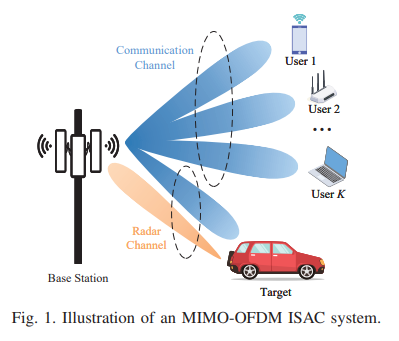
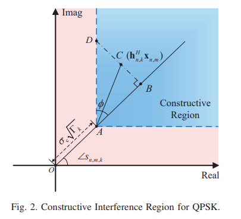
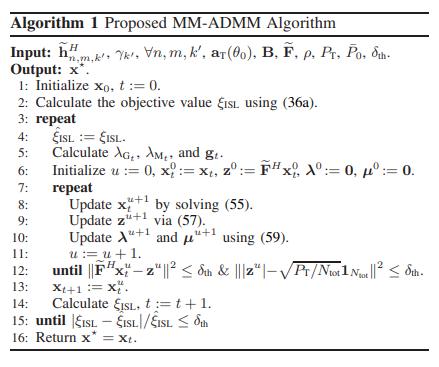
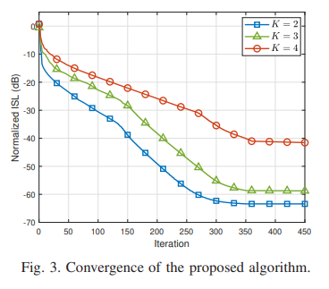
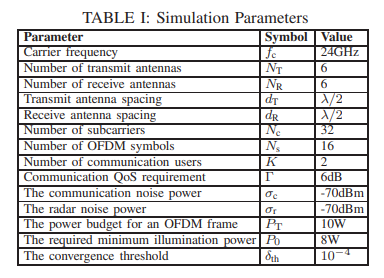
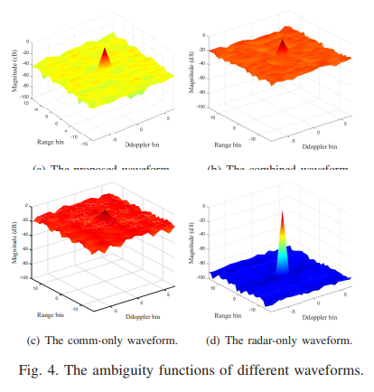
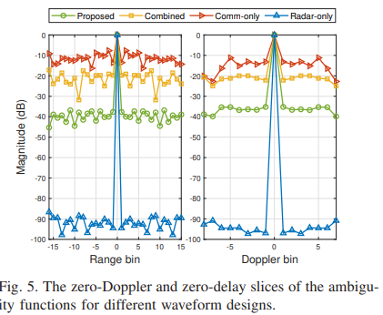
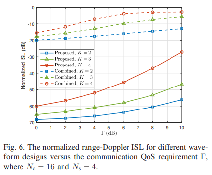
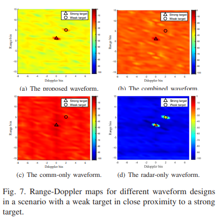
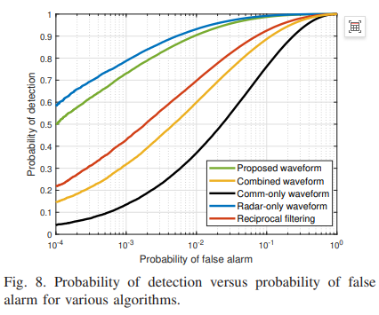
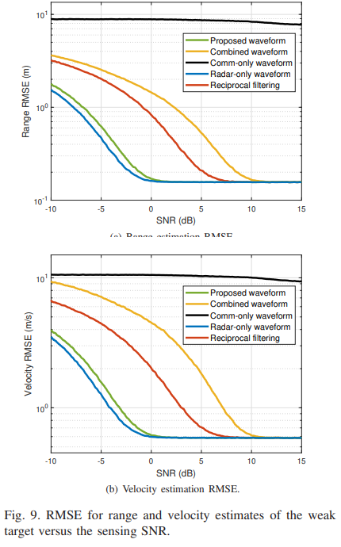

<!-- PAYMENT_BLOCK -->

## Get this dataset

- Payment link (Stripe): [Buy now](https://buy.stripe.com/3cs8yP7sY87d0vu9AB)
- Payment QR code: 

<!-- /PAYMENT_BLOCK -->
